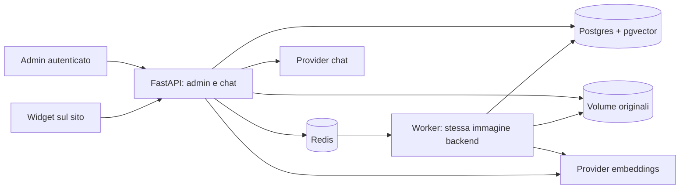

# Graft — progetto rivisto per prima installazione reale

Data: 2026-09-10. Baseline letta: `c16dbae`.
Stato: progetto di riferimento per l'implementazione richiesta dal proprietario;
nessuna funzionalità descritta come nuova è già implementata.

Questo documento sostituisce **scope e ordine delle attività future** della
[specifica originale](2026-09-08-graft-design.md). Conserva il lavoro completato
nelle fasi 1–3a. Le vecchie istruzioni esecutive restano storico, non una seconda
roadmap da seguire contemporaneamente.

## 1. Risultato da consegnare

Un amministratore configura un bot, carica documenti, vede l'esito dell'ingestione
e copia uno script su un sito. Un visitatore pone domande, riceve testo in streaming
e fonti consultabili. Se il corpus non basta, riceve una risposta di astensione.

Prima release: un amministratore attivo, più bot, un percorso provider verificato
dal vivo, PDF testuali/MD/TXT, widget essenziale, amministrazione essenziale.
Conservare gli altri adapter già presenti; dichiararli non verificati dal vivo fino
alle relative prove. Non eliminare modelli utenti o bot_members.

Successivamente: gestione multiutente con RBAC, dashboard Refine completa,
validazione sistematica degli altri provider, parser opzionali. Nessun crawler,
SaaS, analytics avanzata, ANN o SDK aggiuntivo nella prima release.

## 2. Decisioni e alternative

| Tema | Decisione | Alternativa scartata e motivo |
|---|---|---|
| Architettura | Monolite FastAPI modulare | Riscrittura/microservizi non risolvono il problema attuale |
| Dati | Postgres + pgvector, ricerca esatta per bot | HNSW e tabelle per dimensione solo dopo misure |
| Esecuzione | Worker separato, stessa immagine backend | BackgroundTasks nel processo HTTP non offre recupero durevole |
| Coda | Redis + arq, versione risolta e bloccata nel lockfile | Non costruire broker, scheduler o retry framework propri |
| Originali | Volume locale condiviso app/worker | Object storage quando servono nodi su host diversi |
| Admin iniziale | Login e piccola UI HTML/JS servita da FastAPI | SPA completa prima della demo rallenta la verifica |
| Widget | TypeScript vanilla e Shadow DOM | Framework UI non necessario per questo perimetro |
| Qualità | Corpus di valutazione prima del completamento UI | Il solo prompt grounded non dimostra affidabilità |

arq dichiara esplicitamente possibili esecuzioni ripetute: idempotenza e fencing
sono requisiti applicativi, non garanzie di exactly-once del broker.
[Documentazione arq](https://arq-docs.helpmanual.io/#usage), consultata 2026-09-10.

## 3. Architettura obiettivo



Quattro servizi Compose: app, worker, db, redis. Il worker riusa package, config
e immagine dell'app; non diventa un nuovo progetto. App serve `/admin/`,
`/widget/graft.js`, `/api/v1/admin/*`, `/api/v1/chat` e `/health*`.
Nessun orchestratore RAG aggiuntivo.

## 4. Contratti dati

### Originali e documenti

`Document`: mantenere campi attuali, aggiungere `storage_key` nullable per legacy,
`source_sha256` nullable per legacy, `embedding_fingerprint` nullable,
`ingestion_run_id` UUID nullable, `attempt_count` intero default 0,
`lease_expires_at` timestamp nullable. `updated_at` supporta la ricerca dei pending.
Un documento nuovo nasce con file salvato e hash noto. Nome utente è solo metadata.

Storage: `/data/uploads/{bot_uuid}/{document_uuid}/source`, mai usare filename
per comporre un path. Scrivere file temporaneo nella stessa directory, poi rename
atomico. Se insert DB fallisce, rimuovere il file appena creato. Una manutenzione
esplicita trova directory orfane; non cancellare automaticamente file ambigui.
Gli originali non sono serviti pubblicamente e non vengono messi in Redis.

MVP non sostituisce il contenuto di un documento esistente: nuovo upload = nuovo
documento. Retry rielabora lo stesso originale. Eliminazione revoca subito il
documento nel DB e poi elimina il file; worker obsoleto non può ricrearlo.

### Provenienza e chunk

Il parser produce `ParsedSection(text, page, heading)`; `page` è 1-based per PDF,
`heading` è opzionale per MD. Il chunker produce `ChunkDraft(content, metadata)`.
Metadata: pagina/sezione quando disponibili. `position` resta sequenziale per documento.
Chunking per paragrafi con tetto 1.000 caratteri e overlap massimo 200; blocchi
troppo lunghi hanno fallback a finestre. Non fondere pagine diverse in un chunk.
È una baseline misurabile; non promette qualità OCR, tabelle o layout complessi.

PDF senza testo estraibile: `failed`, codice `no_extractable_text`; TXT/MD vuoti:
stesso esito. Modifica intenzionale del comportamento attuale `ready` con zero chunk.
Durante retry fallito i chunk precedenti restano fisicamente integri ma non sono
ricercabili finché il documento non torna `ready`.

### Identità embeddings

Fingerprint SHA-256 del JSON canonico `{provider, model, normalized_base_url}`.
Escludere chiave API; includere qualsiasi futura opzione che cambi i vettori.
URL normalizzato senza slash finale, con endpoint predefinito esplicitamente risolto.
Per endpoint locali con modello sostituito sotto lo stesso nome, l'operatore deve
usare un nuovo identificatore modello: il fingerprint non rileva pesi remoti cambiati.

Configurazione embeddings modificabile solo se non esistono documenti del bot.
Se esistono: HTTP 409 `embedding_config_locked`; consentire rotazione della sola
chiave API. Prima release: creare nuovo bot e ricaricare gli originali. Nessun
re-embed automatico parziale. Config LLM modificabile indipendentemente.

Retrieval deve filtrare `bot_id`, documento `ready` e fingerprint corrente;
confrontare dimensioni prima della distanza. Non confrontare vettori legacy senza
fingerprint. Nel SQL usare sottoquery materializzata o guardia `CASE` per evitare
che il planner valuti la distanza su righe di dimensione incompatibile.
Non usare solo la dimensione per dedurre compatibilità semantica.

## 5. Ingestione affidabile

1. Admin salva originale, inserisce documento `pending` e committa.
2. Enqueue di soli UUID documento/run. Se Redis non risponde il documento resta
   pending; dispatcher periodico lo ritenta. Il DB è la fonte del lavoro da fare.
3. Claim atomico DB assegna run UUID e lease 120 secondi; solo pending o processing
   con lease scaduta possono essere acquisiti. Heartbeat ogni 30 secondi.
4. Parsing in subprocess terminabile (30 secondi). Limiti iniziali: 10 MiB/file,
   200 pagine PDF, 1 milione di caratteri estratti, 2.000 chunk/documento.
5. Embedding batch di massimo 32 chunk; timeout per richiesta 60 secondi; una
   elaborazione documento per worker inizialmente. Timeout job 10 minuti.
6. Prima del commit finale bloccare riga documento e confrontare run UUID e
   fingerprint; se obsoleti, scartare risultato. Sostituire chunk e marcare ready
   nella stessa transazione; azzerare error, lease e tentativi dopo successo.
7. Errori transitori: tre tentativi complessivi, attese 10 e 30 secondi; errori
   permanenti: failed immediato. Non sommare retry SDK e worker senza controllo:
   disabilitare retry SDK per embeddings eseguiti dal worker.

Dispatcher arq ogni 60 secondi riaccoda pending e processing con lease scaduta.
Usare job id stabile per documento; se un vecchio job è ancora registrato,
il dispatcher riprova al giro successivo. `keep_result=0`. Run UUID nel DB è
il fencing token; deduplicazione Redis da sola non basta.
Crash dopo commit ready e prima dell'ack: il job ripetuto vede ready ed esce.
Esaurimento tentativi o timeout: failed, mai processing permanente.

Redis AOF e volume persistente; anche se Redis perde dati, dispatcher ricostruisce
lavoro dal DB. La ripetizione di chiamate embeddings dopo crash può comportare
costi duplicati: accettato, non è exactly-once.

## 6. API e autenticazione

Login FastAPI Users, JWT bearer 60 minuti. Nessuna registrazione pubblica.
CLI `uv run python -m graft.cli create-admin EMAIL` chiede password senza echo;
riusare hashing della libreria, impedire secondo owner nella prima release.
Tutte le API admin richiedono utente attivo owner. Nessuna password o JWT in URL.
UI admin mantiene token in memoria; refresh pagina richiede nuovo login.

| Endpoint | Risposta/semantica |
|---|---|
| `POST /auth/jwt/login` | Contratto FastAPI Users |
| `GET /api/v1/admin/bots` | `{items: [...], total: n}` |
| `POST /api/v1/admin/bots` | 201, bot con widget key casuale pubblica |
| `PATCH /api/v1/admin/bots/{id}` | 200; applica lock embeddings |
| `DELETE /api/v1/admin/bots/{id}` | 204; revoca dati prima di cleanup file |
| `POST /api/v1/admin/bots/{id}/provider/test` | Chat minima + embedding minimo sui modelli selezionati |
| `GET /api/v1/admin/bots/{id}/documents` | Stati, errori sanificati, numero chunk |
| `POST /api/v1/admin/bots/{id}/documents` | Multipart, 202 con documento pending |
| `POST /api/v1/admin/documents/{id}/retry` | 202; solo failed, 409 se già in lavorazione |
| `DELETE /api/v1/admin/documents/{id}` | 204, elimina chunk via cascade |
| `GET /api/v1/admin/bots/{id}/conversations` | Elenco paginato |
| `GET /api/v1/admin/conversations/{id}` | Messaggi e citazioni |
| `POST /api/v1/chat` | SSE, contratto sotto |

Liste: `offset=0`, `limit=20`, massimo 100. Config in risposta non contiene
mai chiavi; restituisce `has_api_key`. Chiave omessa in PATCH = conserva;
null esplicito = elimina. Cifratura prima di persist, non solo helper disponibile.

## 7. Chat e fonti

Request: `{bot_key, session_id?, message}`. Nessuna history arbitraria dal client.
Prima richiesta crea session ID casuale almeno 128 bit; richieste successive
usano quello restituito. Lookup conversazione sempre per bot + sessione.
Session ID è capability del visitatore: non esporre endpoint pubblico di listing.
Massimo 2.000 caratteri input; ultimi 6 messaggi, massimo 8.000 caratteri history.

Retrieval: cosine similarity `1 - distance`, top_k=5, soglia iniziale 0.5,
modificabile tra 0 e 1 per bot e calibrata dal corpus. Budget contesto 6.000
caratteri, output massimo 512 token. Domanda corrente viene embedded direttamente;
query rewriting e retrieval ibrido sono fuori dalla prima release.

Se nessun candidato supera soglia: fallback deterministico, nessuna chiamata LLM.
Altrimenti prompt separa istruzioni, history e documenti non fidati; chiede fonti
con etichette `[S1]`. Alla fine validare riferimenti contro chunk recuperati.
Etichetta inventata = evento finale `error` con codice `invalid_citation`;
non registrare risposta come completata. La UI indica risposta non verificata.
Streaming ha già mostrato testo provvisorio: questa verifica non lo rende
retroattivamente affidabile. Non dichiarare assenza garantita di allucinazioni.

Formato SSE UTF-8, ogni frame termina con riga vuota:

```text
event: meta
data: {"session_id":"...","request_id":"..."}

event: delta
data: {"text":"Risposta [S1]"}

event: done
data: {"answer":"Risposta [S1]","citations":[{"id":"S1","document_id":"...","filename":"manuale.pdf","page":2,"heading":null,"excerpt":"..."}],"grounding":"retrieved"}

```

`done.grounding` è `retrieved` o `no_context`. Fonti mostrate come estratti già
inclusi nel frame, senza URL all'originale. Un bot pubblico espone i contenuti
usati per rispondere: admin deve caricare soltanto materiale destinato ai visitatori.
Validazioni HTTP prima dello stream; errore durante stream = evento `error`
sanificato e chiusura, senza `done`. Heartbeat commento ogni 15 secondi.

Client usa fetch POST + ReadableStream, non EventSource (richiesta POST).
Disconnessione cancella chiamata provider e libera quota concorrenza. Persistenza:
utente all'accettazione; messaggio assistant solo a completamento valido. Nessun
retry automatico dopo il primo token. Aggiungere request_id e status
`completed|failed|cancelled` ai messaggi per distinguere tentativi incompleti.

## 8. Confini e operatività

- Origin esatto schema/host/porta per bot, nessun wildcard, rifiutare assente/null
  sulla chat browser. Preflight OPTIONS non ha bot_key: rispondere solo a origini
  presenti in almeno un bot, poi validare il bot esatto sul POST. `Vary: Origin`.
- CORS non autentica client non-browser: Origin è falsificabile fuori dal browser.
  Widget key è pubblica. Non presentare allowlist come protezione completa dai costi.
- Rate limit Redis atomico: 10 richieste/minuto per bot+IP e 100/minuto per bot;
  massimo 2 generazioni simultanee per bot. IP proxy fidati configurati esplicitamente.
  Session ID non è unico limite. Redis indisponibile = chat 503 prima di chiamare LLM.
- Provider errors: codici pubblici stabili, messaggi fissi; mai `str(exc)` verso
  admin/widget o log. Log request/document ID, classe errore, durata e tentativo.
- Startup prod rifiuta JWT placeholder, chiave Fernet assente/non valida. DB/Redis
  senza porte pubblicate nella configurazione di deploy; override locale separato.
- Docker usa lockfile frozen e uv con versione/digest fissati durante implementazione.
  Migrazioni eseguite una volta prima di avviare worker/app, non da entrambi.
- Backup DB, volume originali e chiave Fernet; restore verificato insieme.
- `retention` conversazioni 30 giorni, cleanup giornaliero CLI; configurabile,
  non introdurre piattaforma analytics. Non registrare token/segreti nei log.

Le regole CORS browser seguono la [documentazione FastAPI](https://fastapi.tiangolo.com/tutorial/cors/).
Limiti numerici sopra sono decisioni iniziali di progetto, non benchmark già misurati.

## 9. Migrazione, consegna, rinvii

Migrazione 0003 additiva: campi nullable per righe legacy; non alterare migrazioni
0001/0002. Vecchi chunk senza provenienza/fingerprint restano nel DB, esclusi dal
nuovo retrieval. Report elenco documenti da ricaricare: i file originali non sono
ricostruibili fedelmente dai chunk. Nessuna cancellazione automatica dei dati storici.

Release gate: test unitari senza Docker; integrazione con DB/Redis; valutazione
RAG live; installazione su pagina demo; riavvio worker; restore; frontend keyboard
e mobile. Licenza scelta dal proprietario prima di distribuzione pubblica.

RBAC e Refine restano milestone successiva esplicita: nessuna rimozione definitiva
del requisito originario. Un parser OCR entra solo dopo fixture che dimostri il
limite; ANN solo dopo benchmark sul corpus rappresentativo.

Piano esecutivo: [2026-09-10-graft-redesign-plan.md](../plans/2026-09-10-graft-redesign-plan.md).
